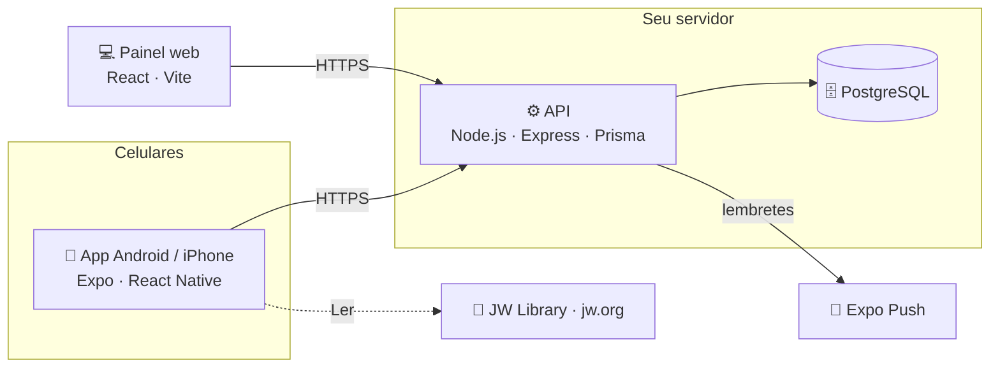

<div align="center">


# Servir Mais

**A congregação no bolso de cada irmão.**

Designações, reunião, grupos de campo, território, o ministério do pioneiro e o estudo
pessoal: um app Android/iPhone com quatro ambientes e um painel web, no seu próprio servidor.

[](LICENSE)
[](https://docs.expo.dev)
[](https://reactnative.dev)
[](https://nodejs.org)
[](https://www.postgresql.org)
[](docker-compose.prod.yml)

[**Instalar**](docs/INSTALACAO.md) · [**Gerar o app**](docs/APP.md) · [**Ambientes**](#-quatro-ambientes-num-app-só) · [**Funcionalidades**](#-funcionalidades) · [**Perguntas frequentes**](#-perguntas-frequentes)

</div>

---

## 🧩 Quatro ambientes num app só

O app é dividido em ambientes. Cada um tem a sua barra, as suas cores e o seu jeito de
trabalhar, e todos usam a mesma conta. Troca-se de ambiente tocando na marca, no topo da tela,
e o app reabre no último ambiente usado.

| Ambiente | Para quem | O que tem |
|---|---|---|
| 📋 **Servir Mais** | Todos | Designações, reunião, grupos de campo, carrinho, confirmações e tarefas da congregação. O "+" cria o quadro do mês, importa a programação e envia o relatório de campo. |
| ⏱️ **Ministério** | Pioneiros auxiliares e regulares, e os admins | Horas com cronômetro e a meta do mês, revisitas e estudos, agenda, progresso e o relatório que vai direto para o grupo. |
| 🗺️ **Território** | Todos (as ações de campo, para dirigentes e quem cuida) | Mapa, lista por áreas, saídas de campo e o painel de quem cuida dos territórios. |
| 📚 **Estudo pessoal** | Todos | Os programas de leitura da Bíblia, a lista do que estudar, a sessão de estudo e a rotina com aviso. |

## ✨ Funcionalidades

<table>
<tr>
<td width="50%" valign="top">

### 📋 Designações
Quadros mensais de microfone, indicadores, áudio e vídeo e estacionamento, com
**preenchimento automático** que respeita funções, indisponibilidades e rodízio. Edição
célula a célula, publicação, histórico e PDF pronto para afixar.

</td>
<td width="50%" valign="top">

### 🙋 Minhas designações
Cada irmão abre o app e vê **só o que é dele**: quadro, reunião, dirigente de campo,
limpeza. Com **lembretes push** na antecedência que ele escolher.

</td>
</tr>
<tr>
<td valign="top">

### 📖 Reunião e Zoom
Importe o **PDF da programação** e o app monta a semana. Exporte em PDF ou imagem,
compartilhe o **convite do Zoom** no WhatsApp e registre a **assistência** (presencial e
Zoom), com estatísticas e uma imagem pronta para o grupo. Quem cuida das reuniões vê os
**relatórios do Zoom**: participantes, resumo e transcrição.

</td>
<td valign="top">

### 🧭 Dirigentes de campo
Saídas de campo por dia e turno, escala mensal gerada pela disponibilidade de cada
dirigente, e PDF da escala.

</td>
</tr>
<tr>
<td valign="top">

### 👥 Grupos e relatório de campo
Os grupos com dirigente e ajudante, importados do **PDF da lista de grupos** (o nome em
verde vira pioneiro regular). No relatório do mês, o dirigente anota cada irmão ou o próprio
publicador **envia pelo app**. Há mensagem pronta no WhatsApp para pedir o relatório, e o
secretário recebe um aviso quando um grupo fecha o mês.

</td>
<td valign="top">

### 🗺️ Território com GPS
Os territórios vêm direto do seu **Google My Maps**. O dirigente vê as quadras no mapa,
**marca pelo GPS onde parou** (funciona **sem internet** e envia sozinho depois), registra a
saída, mantém a lista **Não bater** e gera o **S-13** em PDF.

</td>
</tr>
<tr>
<td valign="top">

### ⏱️ Ministério do pioneiro
O cadastro diz quem é pioneiro **auxiliar (30 h)** ou **regular (50 h)**, e a meta do mês
segue o tipo. O ambiente traz:
- **cronômetro** que fica no servidor;
- **revisitas e estudos** no mapa, com aviso da visita marcada e compartilhamento em imagem ou
  no WhatsApp;
- **agenda** com os planos de saída e o progresso do ano de serviço;
- **quilometragem** e o **calendário** assinado no celular.

</td>
<td valign="top">

### 📚 Estudo pessoal
- **Leitura da Bíblia** por programa:
  - o do **jw.org** (a Bíblia em um ano, por assunto ou pelos marcadores);
  - o "Comece sua leitura da Bíblia";
  - a **leitura semanal da reunião**;
  - a leitura livre.
- Datas planejadas, **regularidade** da semana e "Ler" que abre no **JW Library**.
- Lista do que estudar, **sessão com o passo a passo** dos artigos e **rotina** com aviso e
  plano B.

O conteúdo vem só do jw.org e da Biblioteca On-line.

</td>
</tr>
<tr>
<td valign="top">

### 🛒 Carrinho, ✅ confirmações e tarefas
Pontos e turnos fixos do carrinho. Mensagem pronta no WhatsApp para confirmar as partes de
estudante. Tarefas atribuídas a cada responsável, com painel de prazos.

</td>
<td valign="top">

### 🔔 Lembretes no celular
Push para as **designações** de cada um (na antecedência que ele escolher), as **tarefas**,
o **pedido do relatório** no dia 1, a **visita marcada** do pioneiro e a **rotina de estudo**,
com o plano B de quem ainda não leu a Bíblia no dia.

</td>
</tr>
<tr>
<td valign="top">

### 🔐 Acesso sob medida
Login com **Face ID ou digital**, **foto de perfil** e admin por área: quem cuida dos
dirigentes mexe só nos dirigentes. Quem tem a função **Áudio e vídeo** já opera a tela de
Reunião.

</td>
<td valign="top">

### 🎨 Feito para o dia a dia
Tema claro e escuro, **modo daltônico**, cores próprias em cada ambiente e telas pensadas
para quem não é técnico. As mudanças do app chegam **pelo ar**, sem reinstalar.

</td>
</tr>
</table>

## 🏗️ Como funciona



| Pasta | O quê | Stack |
|---|---|---|
| [`backend/`](backend) | API, regras de designação, relatórios e lembretes | Node 20, Express, Prisma, PostgreSQL |
| [`mobile/`](mobile) | App dos irmãos, com os quatro ambientes | Expo SDK 54, React Native 0.81, TypeScript, TanStack Query |
| [`frontend/`](frontend) | Painel web (opcional) | React 19, Vite |

Cada congregação roda a **sua** instalação: os dados ficam no seu servidor, e uma
instalação nova começa **vazia**, só com o usuário `admin`. Os lembretes saem de um agendador
da própria API, que acorda a cada 15 minutos.

## 🚀 Começando

### Em produção, no seu servidor

```bash
git clone https://github.com/jricardoc/designacoes-jw.git
cd designacoes-jw
cp .env.example .env        # senhas, domínios e fuso
docker compose -f docker-compose.prod.yml up -d --build
```

Banco, API, painel web e HTTPS automático sobem juntos. O passo a passo completo — domínio,
EasyPanel, primeiro acesso e configuração inicial — está no
**[tutorial de instalação](docs/INSTALACAO.md)**.

Depois, gere o app apontando para a sua API: **[guia do app](docs/APP.md)**
(Android é grátis).

### Para desenvolver

```bash
docker compose up --build    # banco + API (3001) + painel web (5173)
cd mobile && npm install && cp .env.example .env && npx expo start
```

A senha do `admin` aparece no log da API no primeiro boot
(`docker compose logs backend | grep "Admin criado"`).

## ❓ Perguntas frequentes

<details>
<summary><b>Quanto custa?</b></summary>

O software é gratuito e de código aberto. Você paga só o servidor (uma VPS simples, a partir
de uns R$ 25/mês) e, se quiser, um domínio. Gerar o app Android é grátis; para iPhone é
preciso a conta de desenvolvedor da Apple (US$ 99/ano). Detalhes no [guia do app](docs/APP.md).
</details>

<details>
<summary><b>Preciso publicar na Play Store ou na App Store?</b></summary>

Não. No Android, você gera um APK e manda o link para os irmãos. No iPhone, a distribuição
interna (sem loja) existe, mas exige a conta paga da Apple; quem não tiver pode usar o painel
web pelo Safari.
</details>

<details>
<summary><b>Os dados da minha congregação ficam com quem?</b></summary>

Com você. Cada instalação tem o próprio servidor e o próprio banco; nada é enviado para este
repositório nem para terceiros (as notificações push passam pelo serviço do Expo, só com o
texto do lembrete). No Ministério e no Estudo pessoal, cada um só vê o que é seu: horas,
contatos, anotações e leituras.
</details>

<details>
<summary><b>Quem vê cada ambiente?</b></summary>

O Servir Mais, o Território e o Estudo pessoal são de todos. O Ministério é dos pioneiros
auxiliares e regulares (marcados no cadastro) e dos admins. Dentro de cada ambiente, o que
cada um pode fazer segue as permissões de sempre: quem cuida de uma área mexe nela.
</details>

<details>
<summary><b>De onde vem o conteúdo do Estudo pessoal?</b></summary>

Só do jw.org e da Biblioteca On-line. O app mostra as referências e dicas curtas, sempre com o
link do artigo de onde saíram, e o "Ler" abre a Bíblia no JW Library (ou no jw.org, para
quem não tem o app). Nenhum texto de publicação é copiado para o app.
</details>

<details>
<summary><b>Dá para usar só o painel web, sem app?</b></summary>

Dá. O painel web roda em qualquer navegador. O app acrescenta os ambientes, as notificações,
Face ID/digital e o uso no dia a dia.
</details>

<details>
<summary><b>Como atualizo para uma versão nova?</b></summary>

No servidor, `git pull` e suba de novo: o banco é atualizado sozinho no boot, sem perder
dados (veja [Backup e atualização](docs/INSTALACAO.md#8-backup-e-atualização)). No app, as
mudanças que são só de código chegam pelo ar; biblioteca nova ou permissão nova pedem um
build novo ([guia do app](docs/APP.md#atualizar-o-app-depois)).
</details>

## 🤝 Contribuindo

Sugestões e correções são bem-vindas: abra uma *issue* ou um *pull request*. Antes de enviar,
rode as verificações:

```bash
cd mobile && npm run typecheck && npm run lint
cd backend && for f in scripts/verificar*.js; do case "$f" in *Banco.js) continue;; esac; node "$f" || exit 1; done
```

Os testes `scripts/verificar*Banco.js` gravam dados: rode-os só num banco descartável
(`ZOOM_TESTE_BANCO=1 DATABASE_URL=...`).

## 📄 Licença

[MIT](LICENSE) — use, modifique e distribua à vontade, mantendo o aviso de copyright.

<sub>Projeto pessoal e sem fins lucrativos, feito por voluntários. Não é um produto oficial
nem tem vínculo com a organização das Testemunhas de Jeová ou com o jw.org.</sub>
