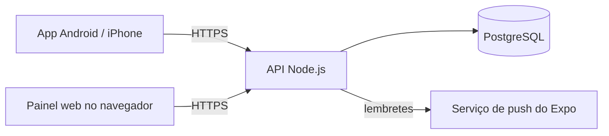

# Tutorial de instalação

Este guia leva você do zero até o Servir Mais funcionando para a sua congregação: o servidor
no ar, o primeiro acesso, a configuração inicial e o app nos celulares.

> **Quanto custa?** O software é gratuito. Você só paga o servidor (uma VPS simples,
> a partir de uns R$ 25/mês) e, se quiser, um domínio próprio (uns R$ 40/ano). Gerar o app
> Android é de graça. Para iPhone, veja [o guia do app](APP.md#iphone-ios).

## Sumário

1. [Como o sistema é montado](#1-como-o-sistema-é-montado)
2. [O que você precisa](#2-o-que-você-precisa)
3. [Instalar no servidor](#3-instalar-no-servidor) — [Opção A: VPS com Docker](#opção-a-vps-com-docker-compose) · [Opção B: EasyPanel](#opção-b-easypanel)
4. [Primeiro acesso](#4-primeiro-acesso)
5. [Configuração inicial no app](#5-configuração-inicial-no-app)
6. [Territórios: My Maps e cartões](#6-territórios-my-maps-e-cartões)
7. [O app no celular](#7-o-app-no-celular)
8. [Backup e atualização](#8-backup-e-atualização)
9. [Problemas comuns](#9-problemas-comuns)
10. [Referência das variáveis](#10-referência-das-variáveis)

---

## 1. Como o sistema é montado



São três peças, todas neste repositório:

| Peça | Pasta | O que faz |
|---|---|---|
| **API** | `backend/` | Regras, login e dados. É a única que fala com o banco. |
| **Banco** | — | PostgreSQL. Guarda tudo, inclusive as fotos de perfil. |
| **Painel web** | `frontend/` | Opcional. Versão para o navegador do computador. |
| **App** | `mobile/` | O que os irmãos usam no dia a dia. Você gera o seu (passo 7). |

A instalação nasce **vazia**: sem irmãos, sem quadros, sem programação. Só existe o usuário
`admin`. Tudo o resto você cadastra pelo app.

## 2. O que você precisa

- **Um servidor** com Linux e pelo menos 1 GB de RAM (2 GB é mais folgado). Qualquer VPS
  serve: Hostinger, Contabo, DigitalOcean, Oracle Cloud (tem plano gratuito) etc.
- **Um domínio** ou subdomínio para a API, por exemplo `api.minhacongregacao.com.br`.
  O celular só conversa com a API por **HTTPS**, e o certificado precisa de um domínio.
- **Uma conta gratuita no [Expo](https://expo.dev)**, para gerar o app (passo 7).
- **Git** e noções básicas de terminal. Os comandos estão todos aqui, é só copiar.

## 3. Instalar no servidor

Escolha **uma** das opções.

### Opção A: VPS com Docker Compose

O caminho mais direto: um comando sobe banco, API, painel web e o HTTPS automático (Caddy).

**3.1. Aponte os domínios.** No painel onde você comprou o domínio, crie dois registros do
tipo **A** apontando para o IP do servidor:

| Nome | Tipo | Valor |
|---|---|---|
| `api` (vira `api.minhacongregacao.com.br`) | A | IP do servidor |
| `@` ou `www` (o painel web) | A | IP do servidor |

**3.2. Instale o Docker** no servidor (Ubuntu/Debian):

```bash
curl -fsSL https://get.docker.com | sh
```

**3.3. Baixe o projeto e configure:**

```bash
git clone https://github.com/jricardoc/designacoes-jw.git
cd designacoes-jw
cp .env.example .env
nano .env
```

No `.env`, preencha pelo menos:

| Variável | O que colocar |
|---|---|
| `POSTGRES_PASSWORD` | Uma senha forte. Gere com `openssl rand -hex 24` |
| `JWT_SECRET` | Outro segredo. Gere com `openssl rand -hex 32` |
| `API_DOMAIN` | O domínio da API, ex.: `api.minhacongregacao.com.br` |
| `WEB_DOMAIN` | O domínio do painel web, ex.: `minhacongregacao.com.br` |
| `FUSO_HORARIO` | O fuso da congregação, ex.: `America/Sao_Paulo`, `America/Manaus` |
| `SENHA_PADRAO` | A senha que novos usuários recebem (o padrão, `jw1010`, é público) |

Salve com `Ctrl+O`, `Enter` e saia com `Ctrl+X`.

**3.4. Suba tudo:**

```bash
docker compose -f docker-compose.prod.yml up -d --build
```

A primeira vez demora alguns minutos. Acompanhe com
`docker compose -f docker-compose.prod.yml logs -f backend` e espere a linha
`Server running on port 3001`. Pronto: siga para o [primeiro acesso](#4-primeiro-acesso).

### Opção B: EasyPanel

Se o servidor tem o [EasyPanel](https://easypanel.io) (ou Coolify, Dokploy, que são parecidos),
crie três serviços no mesmo projeto:

**1. Banco** → *Add service* → *Postgres*. Anote a *Internal connection URL*.

**2. API** → *Add service* → *App*:
- **Source:** GitHub, este repositório (ou o seu fork), branch `main`, *Build path* `/backend`.
- **Build:** *Dockerfile*, arquivo `Dockerfile.prod`.
- **Environment:**
  ```env
  DATABASE_URL=<a connection URL do passo 1>
  JWT_SECRET=<openssl rand -hex 32>
  FRONTEND_URL=https://minhacongregacao.com.br
  SENHA_PADRAO=<uma senha sua>
  FUSO_HORARIO=America/Sao_Paulo
  ```
- **Domains:** `api.minhacongregacao.com.br`, porta **3001**, HTTPS ligado.
- **Mounts** (só se for usar mapas de território): um *Volume* montado em
  `/app/public/territorios`.

**3. Painel web (opcional)** → *Add service* → *App*:
- **Source:** o mesmo repositório, *Build path* `/frontend`, *Dockerfile* `Dockerfile.prod`.
- **Build args / Environment:** `VITE_API_URL=https://api.minhacongregacao.com.br`
  (o Vite grava esse endereço no build; mudou, faça *Rebuild*).
- **Domains:** `minhacongregacao.com.br`, porta **80**.

Faça o *Deploy* da API e abra os *Logs*: espere `Server running on port 3001`.

> A API aplica o banco sozinha a cada deploy (`npm run migrar`). Numa instalação nova ela
> cria todas as tabelas de uma vez; depois, só aplica as mudanças novas.

## 4. Primeiro acesso

1. **Pegue a senha do admin.** Se você não definiu `ADMIN_SEED_PASSWORD`, a API gerou uma
   senha aleatória e mostrou **uma única vez** no log do primeiro boot:
   ```
   >>> Admin criado: nickname=admin  senha=Xk3...  (troque no primeiro acesso) <<<
   ```
   No Docker: `docker compose -f docker-compose.prod.yml logs backend | grep "Admin criado"`.
2. **Confira se a API responde:** abra `https://api.minhacongregacao.com.br/health` no
   navegador. Deve aparecer `{"status":"ok",...}`.
3. **Entre** pelo painel web (ou pelo app, depois do passo 7) com `admin` e essa senha.
4. **Troque a senha** em *Conta → Alterar senha*.

## 5. Configuração inicial no app

Faça nesta ordem, logado como `admin`:

| # | Onde | O quê |
|---|---|---|
| 1 | **Ajustes → Congregação** | O nome, ex.: `Congregação Vila Nova`. Aparece no login, nos PDFs e nos convites. |
| 2 | **Ajustes → Zoom das reuniões** | Link, ID, senha e horário da sala, para meio e fim de semana. Sem isso, o "Compartilhar" da reunião não oferece o convite do Zoom. |
| 3 | **Ajustes → Grupos de campo** | Os grupos (opcional). |
| 4 | **Menu → Publicadores** | Cadastre os irmãos e marque as **funções** de cada um: microfone, indicador, áudio e vídeo, estacionamento, carrinho, dirigente. É delas que saem os quadros. |
| 5 | **Conta → Usuários → Novo** | Crie o acesso de cada irmão e **vincule ao cadastro dele**. Sem o vínculo, ele não vê as próprias designações. A senha inicial é a `SENHA_PADRAO`. |
| 6 | **Conta → ⋯ → Áreas de acesso** | Dê a cada responsável só a área dele (designações, dirigentes, reuniões, carrinho, confirmações, territórios). |
| 7 | **Reunião → Importar PDF** | Envie a programação da reunião do mês (o PDF da apostila). |
| 8 | **Território → Gerenciar → Mapas do My Maps** | Importe os territórios dos seus mapas do Google My Maps ([passo 6](#6-territórios-my-maps-e-cartões)). |

> **Dica:** quem tem a função **Áudio e vídeo** no cadastro e a conta vinculada já recebe,
> sozinho, acesso completo à tela de Reunião: importar a programação, registrar e compartilhar
> a assistência. Do mesmo jeito, quem tem a função **Dirigente** já pode registrar saídas e
> marcar pontos no território. Não precisa dar a área um por um.

## 6. Territórios: My Maps e cartões

### Do Google My Maps (recomendado)

Se a congregação desenha os territórios no [Google My Maps](https://www.google.com/maps/d/),
o app usa esses mapas direto: **cada camada vira um território, cada polígono vira uma quadra**.

1. No My Maps, abra o mapa → **Compartilhar** → "Qualquer pessoa com o link pode ver".
2. No app, como admin (ou com a área Territórios): **Território → Gerenciar → Mapas do My Maps**.
3. Cole os links (um por linha) e toque em **Ler os mapas**.
4. Confira o **número** de cada território. O app sugere pelo nome; camadas repetidas em dois
   mapas vêm desmarcadas.
5. **Importar**.

Mudou o desenho no My Maps? **Atualizar do My Maps** busca as mudanças sem perder números,
saídas nem pontos marcados. O caminho contrário (gravar no My Maps pelo app) o Google não
permite.

Depois da importação, os dirigentes têm no território:
- o mapa com as quadras, a localização deles e os pontos marcados;
- **Marcar onde estou** pelo GPS (Paramos aqui, Próximo começa aqui, Trecho concluído, Não bater,
  Observação), **com ou sem internet**;
- **Registrar saída**: concluímos o território, ou onde paramos;
- a lista **Não bater**, com reconfirmação a cada 3 meses;
- histórico, designações (aparecem em "Minhas designações"), painel e o **S-13 em PDF**.

Para o mapa aparecer dentro do app no Android, configure a chave do Google Maps
([guia do app](APP.md#mapa-do-território-google-maps)).

### Cartões em imagem (opcional)

Os cartões escaneados continuam valendo como **"cartão original"** de cada território. Eles não
ficam no banco nem no repositório: são imagens numa pasta do servidor, lidas pela API e casadas
pelo número do território. Sem a pasta, nada quebra.

Monte uma pasta assim:

```
territorios/
├── territorios.json
├── 01-mapa.jpg
├── 01-thumb.jpg        (miniatura para a lista, ~400 px de largura)
├── 01-satelite.jpg     (opcional)
└── ...
```

O `territorios.json`:

```json
{
  "territorios": [
    {
      "numero": 1,
      "localidade": "Rua das Flores",
      "arquivos": { "mapa": "01-mapa.jpg", "satelite": null, "thumb": "01-thumb.jpg" }
    }
  ]
}
```

Onde colocar:
- **Docker Compose:** a pasta `territorios/` ao lado do `docker-compose.prod.yml`, e depois
  `docker compose -f docker-compose.prod.yml restart backend`.
- **EasyPanel:** envie os arquivos para o volume montado em `/app/public/territorios`
  (pelo gerenciador de arquivos do painel ou por SFTP) e reinicie a API.

Enquanto nada for importado do My Maps, a lista de territórios mostra só os cartões.

## 7. O app no celular

O app precisa ser gerado **por você**, apontando para a sua API. Siga o
**[guia do app](APP.md)**: em resumo, você preenche o `mobile/.env`, cria um projeto gratuito
no Expo e gera o APK para Android com um comando.

## 8. Backup e atualização

**Backup do banco** (Docker Compose). Agende com `crontab -e` para rodar todo dia:

```bash
docker compose -f docker-compose.prod.yml exec -T postgres \
  pg_dump -U servirmais designacoes | gzip > backup-$(date +%F).sql.gz
```

No EasyPanel, o serviço de Postgres tem backup automático em *Backups*.

**Atualizar para a versão mais nova:**

```bash
git pull
docker compose -f docker-compose.prod.yml up -d --build
```

No EasyPanel, *Deploy* de novo (ou ligue o *Auto deploy*). O banco é atualizado sozinho no
boot, sem apagar dados.

## 9. Problemas comuns

| Sintoma | Causa provável e solução |
|---|---|
| O app diz "Sem conexão com o servidor" | `EXPO_PUBLIC_API_URL` errado no build, ou a API sem HTTPS. Abra `/health` no navegador do celular. |
| O painel web não loga, e o console mostra erro de CORS | `FRONTEND_URL` da API diferente do endereço do painel (com `https://` e sem barra no fim). |
| "JWT_SECRET nao definido" no log | Faltou a variável `JWT_SECRET`. |
| Não achei a senha do admin | Ela só aparece no primeiro boot. Apague o banco e suba de novo, ou defina `ADMIN_SEED_PASSWORD` antes da primeira vez. |
| Log com "a migracao do banco FALHOU" | Rode `docker compose -f docker-compose.prod.yml exec backend npx prisma migrate status`. Se a primeira instalação parou no meio, o mais simples é apagar o banco (`docker compose -f docker-compose.prod.yml down -v`) e subir de novo. |
| O certificado HTTPS não sai | O domínio ainda não aponta para o IP do servidor, ou as portas 80/443 estão fechadas no firewall. |
| Os lembretes chegam na hora errada | Ajuste `FUSO_HORARIO` e o horário das reuniões em *Ajustes → Configurar notificações*. |
| Ninguém recebe notificação no Android | Falta configurar o Firebase. Veja [o guia do app](APP.md#notificações-push-opcional). |

## 10. Referência das variáveis

**API (`backend`)**

| Variável | Obrigatória | Padrão | Descrição |
|---|---|---|---|
| `DATABASE_URL` | sim | — | Conexão do PostgreSQL. |
| `JWT_SECRET` | sim | — | Segredo que assina os logins. Sem ele a API não inicia. |
| `FRONTEND_URL` | para o painel web | — | Endereço(s) do painel web liberado(s) no CORS, separados por vírgula. |
| `ADMIN_SEED_PASSWORD` | não | aleatória | Senha do `admin` criado no primeiro boot. |
| `SENHA_PADRAO` | não | `jw1010` | Senha de quem o admin cria ou redefine. Troque. |
| `FUSO_HORARIO` | não | `America/Sao_Paulo` | Fuso da congregação (lembretes, saudações). |
| `LEMBRETES_ATIVOS` | não | ligado | `false` desliga os lembretes push. |
| `JWT_EXPIRES_IN` | não | `7d` | Validade do login. |
| `PORT` | não | `3001` | Porta da API. |

**Painel web (`frontend`, no build)**

| Variável | Descrição |
|---|---|
| `VITE_API_URL` | Endereço público da API. |

**App (`mobile/.env`)** — veja [o guia do app](APP.md#1-configure-o-mobileenv).
